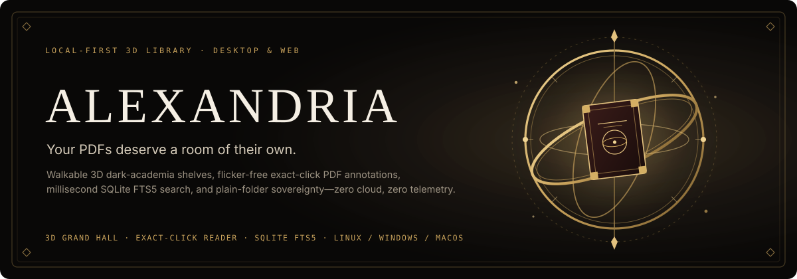
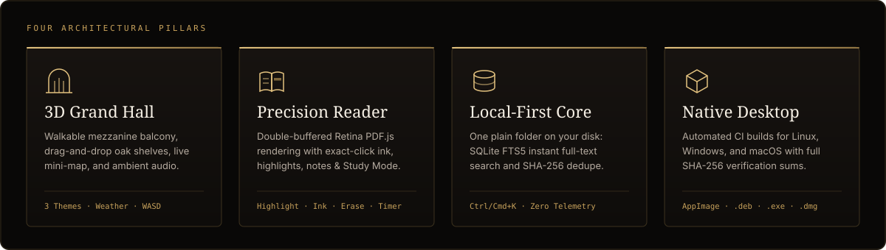
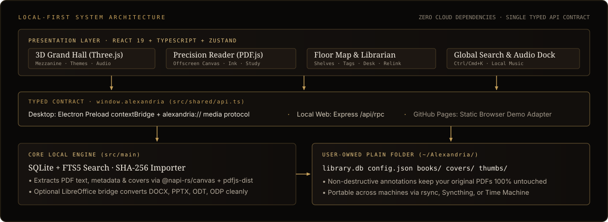
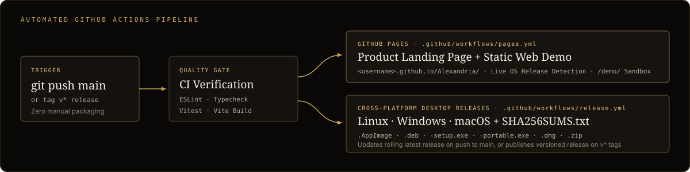

<p align="center">
  
</p>

<p align="center">
  <a href="#downloads"></a>
  <a href="docs/USER_GUIDE.md"></a>
  <a href="docs/CONTROLS.md"></a>
  <a href="CONTRIBUTING.md"></a>
  <a href="#license"></a>
</p>

<p align="center">
  <strong>A private, architectural 3D reading room and precision PDF annotator.</strong><br />
  Walkable shelves · Exact-click highlights &amp; ink · SQLite FTS5 search · Plain-folder storage · Zero telemetry.
</p>

---

<p align="center">
  
</p>

## Why Alexandria?

Most PDF tools treat books like disposable email attachments trapped in flat folder lists—or lock your reading history behind a cloud subscription. **Alexandria** restores spatial memory and calm craftsmanship to your personal archive:

- **Walkable 3D Grand Hall** — Traverse the marble nave and climb the staircase to the upper mezzanine balcony surrounded by real leather-bound spines, a rotating celestial armillary, rolling ladders, marble busts, and warm braziers.
- **Switchable Hall Themes & Soundscapes** — Shift seamlessly between **Dark Academia**, **Sunlit Marble**, and **Observatory** atmospheres with dynamic time-of-day weather moods and layered procedural audio (rain, hearth fireplace, chimes) plus a local music dock.
- **Direct Spatial Shelving** — Drag and drop books directly between shelves in 3D, add custom wings and shelves from the hall, inspect volumes with quick preview cards, and track reading progress right on each spine.
- **Flicker-Free, Exact-Click PDF Reader** — Double-buffered offscreen canvas rendering keeps pages razor-sharp without flashing. Mark passages with five archival highlight tones, freehand ink, margin notes, bookmarks, and an exact-hit eraser—plus a distraction-free **Study Mode** with a built-in session timer.
- **Local-First Sovereignty** — Every library is an ordinary folder (`~/Alexandria`) containing `library.db`, `config.json`, `books/`, and `covers/`. Original PDFs are never mutated, duplicates are caught via SHA-256, and `Ctrl/Cmd+K` searches titles, authors, full page text, and margin notes in milliseconds via SQLite FTS5.

---

## Downloads

Pre-built desktop packages are built and verified automatically by GitHub Actions on every release:

| Platform | Architecture | Recommended Format | Alternative Format |
| :--- | :--- | :--- | :--- |
| **Linux** | `x64` | `.AppImage` (portable, universal) | `.deb` (Debian / Ubuntu) |
| **Windows** | `x64` | `-setup.exe` (NSIS installer) | `-portable.exe` (zero-install) |
| **macOS** | `arm64` (Apple Silicon) | `.dmg` (Disk Image) | `.zip` (Archive) |

Every release publishes a `SHA256SUMS.txt` manifest so you can verify your download before running:

```sh
# Linux
sha256sum -c SHA256SUMS.txt
chmod +x Alexandria-*.AppImage
./Alexandria-*.AppImage

# macOS
shasum -a 256 -c SHA256SUMS.txt
```

> **Try in Browser:** Once GitHub Pages is enabled in repository settings, Alexandria's interactive landing page and static browser demo are automatically deployed at `https://<your-username>.github.io/Alexandria/`.

---

## Documentation

| Document | Description |
| :--- | :--- |
| **[User Guide](docs/USER_GUIDE.md)** | First-run setup, importing PDFs & Office docs, 3D Grand Hall features, Reader workflow, backups, and troubleshooting |
| **[Controls & Shortcuts](docs/CONTROLS.md)** | Complete keyboard and pointer reference for Hall navigation, Reader annotations, Study Mode, and global shortcuts |
| **[Architecture Guide](docs/ARCHITECTURE.md)** | System boundaries, SQLite FTS5 schema, double-buffered PDF rendering, Three.js simulation, and GitHub Pages build pipeline |
| **[Contributing Guide](CONTRIBUTING.md)** | Local setup, coding standards, testing workflow, and pull request checklist |
| **[Security Policy](SECURITY.md)** | Threat model, local-first privacy guarantees, and responsible vulnerability disclosure |
| **[Code of Conduct](CODE_OF_CONDUCT.md)** | Community standards and participation guidelines |
| **[Changelog](CHANGELOG.md)** | Release history and notable milestones |

---

## System Architecture

<p align="center">
  
</p>

Alexandria keeps all business logic, persistence, and UI cleanly typed behind a single `window.alexandria` contract (`src/shared/api.ts`), enabling native **Electron Desktop**, local **Express + Vite Web**, and **Static GitHub Pages Demo** runtimes from one codebase. See [docs/ARCHITECTURE.md](docs/ARCHITECTURE.md) for the full deep dive.

---

## Automated Releases & GitHub Pages

<p align="center">
  
</p>

Three workflows keep quality, desktop releases, and the product landing page continuously synchronized:

1. **Continuous Integration (`.github/workflows/ci.yml`)** — Runs ESLint, TypeScript typechecking, Vitest unit/integration tests, and production builds on every push and pull request.
2. **Product Landing Page & Web Demo (`.github/workflows/pages.yml`)** — On every push to `main`, automatically builds the scroll-choreographed 3D landing page (`site/`) and the static in-browser interactive demo (`/demo/`), publishing both to `<username>.github.io/Alexandria`.
   - *One-time GitHub setup:* Go to **Settings → Pages → Build and deployment → Source** and select **GitHub Actions**.
3. **Cross-Platform Desktop Releases (`.github/workflows/release.yml`)** — On push to `main`, builds fresh Linux, Windows, and macOS packages and updates the rolling **`latest`** GitHub Release. Pushing a version tag (`git tag v0.2.0 && git push --tags`) syncs `package.json`, builds all platforms, generates `SHA256SUMS.txt`, and publishes a permanent versioned release.

---

## Local Development

Requires **Node.js 22+** and **npm**. [LibreOffice](https://www.libreoffice.org/) is optional (used only if you import `.docx`, `.pptx`, `.odt`, or `.odp` files).

```sh
# 1. Clone and install dependencies
git clone https://github.com/<your-username>/Alexandria.git
cd Alexandria
npm install

# 2. Launch local web server (Landing Page at / and live Alexandria app at /demo/)
npm run dev

# 3. Or launch the native Electron desktop app
npm run dev:electron
```

### Available Scripts

```sh
npm run dev            # Express + Vite dev server on http://localhost:3000 (Landing at /, App at /demo/)
npm run dev:electron   # Native Electron desktop app with HMR
npm run build          # Typecheck + production web bundle (dist/)
npm run build:electron # Typecheck + Electron production build (out/)
npm run build:landing  # Build standalone product landing page (dist-pages/)
npm run build:pages    # Build full GitHub Pages bundle (landing + static /demo/ sandbox)
npm run typecheck      # Strict TypeScript checks (node + renderer + landing site)
npm run lint           # ESLint across the entire repository
npm test               # Vitest unit & integration test suite
npm run test:e2e       # Build Electron and run Playwright E2E specs
npm run icons          # Regenerate build/icon.png and build/icon.ico
npm run dist:linux     # Package Linux AppImage + .deb into release/
npm run dist:win       # Package Windows installer + portable .exe into release/
npm run dist:mac       # Package macOS .dmg + .zip into release/
```

Set `ALEXANDRIA_LIBRARY_PATH` to point Alexandria at any custom or portable library folder:

```sh
ALEXANDRIA_LIBRARY_PATH=/path/to/my-library npm run dev:electron
```

---

## Repository Structure

```text
.github/           CI, GitHub Pages deploy, cross-platform Release workflows & Issue/PR templates
docs/              User Guide, Controls Reference, Architecture Guide & custom product SVGs
scripts/           Icon generator & GitHub Pages dual-bundle build script
site/              Standalone product landing page (Three.js 3D Armillary & Hinged Folio + Lenis)
src/main/          Electron main process: SQLite + FTS5, SHA-256 importer, PDF inspection, music, IPC
src/preload/       Typed contextBridge API exposing window.alexandria
src/renderer/      React 19 UI: 3D Grand Hall, Precision Reader, Floor Map, Librarian, Index & Static Demo
src/shared/        Shared domain types, API contract & IPC channel names
tests/             Playwright E2E specs & fixtures
```

---

## Contributing

Contributions are warmly welcomed—whether you are improving 3D hall acoustics, refining PDF annotation ergonomics, adding documentation, or reporting bugs. Please read [CONTRIBUTING.md](CONTRIBUTING.md) and our [Code of Conduct](CODE_OF_CONDUCT.md) before opening a pull request.

## License

Alexandria is open-source software licensed under the **MIT License**.
