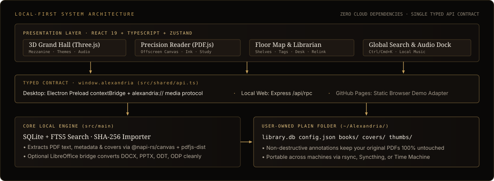

# Alexandria Architecture Guide

This document explains how Alexandria achieves native desktop performance, local-first data integrity, and zero-backend web demo portability from a single TypeScript codebase.

  

---

## 1. Core Architectural Principle: One Typed Bridge

Every piece of UI inside `src/renderer/` communicates with storage and services exclusively through the typed `AlexandriaApi` interface defined in `src/shared/api.ts` and exposed at `window.alexandria`.

This separation allows three distinct runtimes without branching UI components:

| Runtime | Bridge Implementation | Storage / Media |
| :--- | :--- | :--- |
| **Native Desktop (Electron)** | `src/preload/index.ts` via `contextBridge` + `ipcRenderer` | Local SQLite (`node:sqlite` / `library.db`) + custom `alexandria://` protocol |
| **Local Web Dev (`server.ts`)** | `src/renderer/src/web-bridge.ts` via `/api/rpc/:method` | Express server sharing the exact same `src/main/` SQLite & importer modules |
| **GitHub Pages Demo (`/demo/`)** | `src/renderer/src/static-demo-bridge.ts` (`VITE_STATIC_DEMO=true`) | In-browser state + `localStorage` + procedural PDF-1.4 classical sample folios |

---

## 2. Main Process & Persistence (`src/main/`)

### SQLite + FTS5 Schema

All durable state resides in a single SQLite database (`library.db`) managed by versioned migrations (`src/main/db/migrations.ts`):

- **Spatial Hierarchy:** `floors -> rooms -> sections -> bays -> shelves`, supporting append-only auto-growth, undoable growth steps, and user-created wings.
- **Books & Deduplication:** `books` stores metadata, `sha256` content digest, `storage_mode` (`copy` or `link`), shelf/slot coordinates, `reading_state`, `desk_pinned`, and per-book JSON reader preferences.
- **Full-Text Search:** `pages` + an **FTS5 virtual table** index extracted page text alongside titles, authors, and annotation notes for sub-10ms `Ctrl/Cmd+K` queries.
- **Non-Destructive Annotations:** `annotations` stores `highlight`, `note`, `ink`, and `bookmark` records using normalized page coordinates (`[0..1]`), ensuring annotations remain pixel-accurate across zoom levels, DPI changes, and window resizes without ever mutating the original PDF file.

### Document Importer & Media Pipeline

- **Inspection (`src/main/pdf/inspect.ts`):** Uses `pdfjs-dist` with `@napi-rs/canvas` (unpacked outside `app.asar` via `asarUnpack` in `electron-builder.yml`) to inspect page counts, extract text layers, and render cover PNGs and page thumbnails.
- **Office Conversion:** Optional LibreOffice headless conversion turns `.docx`, `.pptx`, `.odt`, and `.odp` files into standard PDFs during import.
- **Local Music Scanner (`src/main/music/scan.ts`):** Extracts tags and embedded cover artwork via `music-metadata` from user-selected local directories.

---

## 3. 3D Grand Hall Simulation (`src/renderer/src/room/`)

- **Database-Driven Spatial Projection:** Shelves, bays, and individual leather book spines are projected deterministically from the SQLite layout tree—adding a shelf or dragging a book updates both the database and the 3D scene immediately.
- **Navigation & Staircase Physics:** First-person movement uses frame-rate-independent delta integration, wall/bay collision boundaries, and smooth elevation interpolation through the grand staircase mouth onto the upper mezzanine balcony.
- **Atmosphere & Procedural Audio:** Switchable theme presets (`dark-academia`, `sunlit-marble`, `observatory`) dynamically adjust Three.js lighting, fog, and material palettes, while Web Audio synthesizes rain, hearth fire, and ambient chimes with zero external audio downloads.

---

## 4. Precision PDF Reader (`src/renderer/src/views/ReaderView.tsx`)

- **Flicker-Free Double-Buffered Rendering:** Each PDF page renders to an offscreen canvas at full `devicePixelRatio` before atomic swap onto the visible canvas, eliminating blank-white flashes during zoom or page turns.
- **Exact-Coordinate Interaction:** Pointer coordinates are transformed cleanly into normalized page space (`(client - rect.origin) / rect.size`), ensuring highlights, freehand ink strokes, and erase hit-testing land precisely where the user clicks.
- **Study Mode & Session Tracking:** Zustand stores persist study timers, theme tone, and per-book reader configuration cleanly through `window.alexandria`.

---

## 5. Product Landing Page & GitHub Pages Dual Build (`site/`)

The product landing page lives in `site/` as an isolated Vite + Tailwind CSS + Three.js application so marketing assets never bloat the Electron desktop binary:

- **Single Centerpiece WebGL Stage (`site/src/scene/ArmillaryFolioStage.tsx`):** A sticky Three.js canvas renders a procedural multi-ring Brass Celestial Armillary Sphere cradling a hinged Leather-Bound Illuminated Folio whose covers smoothly open during scroll choreography (Chapter III).
- **Live Release Resolution (`site/src/lib/releases.ts`):** Detects the visitor's OS and dynamically queries the GitHub Releases API using `VITE_GITHUB_REPO` (injected at build time from `${{ github.repository }}`) or runtime `<owner>.github.io/<repo>` inference—requiring zero hardcoded usernames.
- **Dual-Output Pages Script (`scripts/build-pages.mjs`):** Compiles the landing site into `dist-pages/` (with subpath `/<repo>/`) and the static interactive demo into `dist-pages/demo/` (with subpath `/<repo>/demo/` and `VITE_STATIC_DEMO=true`), deployed automatically by `.github/workflows/pages.yml`.
